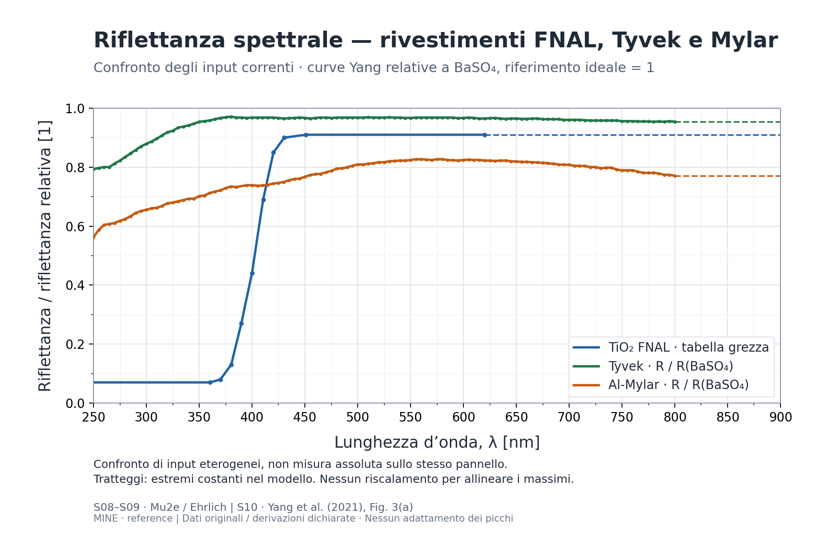

# Source-specific outer coating spectra

Current explicit Geant4 references:

| Material key | Angular approximation | Spectral source | Config |
|---|---|---|---|
| `fnal_tio2` | Lambertian | Untuned baseline attributed to Anna in Mu2e CRVStandalone; intended for FNAL/NICADD coextruded PS/TiO2 | `geant4_optics_diffuse.conf` |
| `tyvek` | Effective Lambertian | Yang et al. 2021, Tyvek 150 um, unirradiated | `geant4_optics_tyvek.conf` |
| `aluminized_mylar` | Specular | Yang et al. 2021, Al Mylar 10 um, unirradiated | `geant4_optics.conf` (default) |
| `constant` | Specular or diffuse | User/model hypothesis, scalar `reflectivity` | Historical monochromatic/BC-621 configs |

Select in any explicit optical config, independently of fiber geometry and
scintillation spectrum:

```
coatingModel=diffuse
coatingMaterial=fnal_tio2
```

For Tyvek use `coatingMaterial=tyvek`, `coatingModel=diffuse` and
`coatingReferenceAlbedo=1`. For Mylar use `coatingMaterial=aluminized_mylar`,
`coatingModel=specular` and `coatingReferenceAlbedo=1`. **Remove scalar
`reflectivity` when selecting a spectral material**: combining both is an error,
so a legacy 98% does not silently override a source curve. Geometry variations
can select these material keys later; no new geometrical variations are created
by this change. All supplied profiles keep the original source choice; set
`scintillationSpectrum=fnal_extruded` to use the FNAL fluorescence proxy.

These options apply only to `--transport geant4`. Existing optical MC response
tables retain their original coating assumptions.

## FNAL coextruded TiO2

Source: [Mu2e CRVStandalone, pinned revision](https://github.com/Mu2e/CRVStandalone/blob/c56260aa5151332939764c2ac3f7b2e69c10e78e/wls/src/WLSDetectorConstruction.cc#L300).
The `p_TiO2` / `refl_TiO2` table is copied exactly, before the source applies an
empirical correction `R_tuned=1-0.75*(1-R_raw)` to improve agreement with Mu2e's
test-beam results. MINE does NOT apply that correction to a different detector.
The source comments attribute the baseline numbers to Anna. These are traceable
simulation-input values, not a newly retrieved laboratory report with batch,
instrument and calibration uncertainties. See `fnal_tio2_energy.csv`.

The companion [Ehrlich 2019 simulation paper](https://arxiv.org/abs/1910.04846)
describes FNAL/NICADD extrusions of PS + 1% PPO + 0.03% POPOP, with a coextruded
0.25 mm layer of 30 wt% TiO2 + 70 wt% PS. This is a much closer reference than
BC-621 paint, but is not a certificate for the 12.5-15% MINOS recipe or any
future MINE batch. Original linear-energy interpolation is retained. Above
3.44 eV, the low-reflectance plateau is an explicit assumption already present
in the source. No arbitrary shift is made to align with the scintillator peak.

Representative untuned probabilities: R(400 nm) ~0.441, R(420 nm) ~0.845,
R(425 nm) ~0.873, R(450 nm) ~0.909, and R(500 nm)=0.91. Its relatively broad
high-reflectance region is not a narrow emission peak.

Mu2e's angular microfacet parameters are NOT imported. MINE keeps the effective
Lambertian coating law. [MINOS detector paper, section 3.2](https://arxiv.org/abs/0805.3170)
reports Lambert-law tests for its coextruded reflector. Real angular response
and batch-dependent reflectance remain calibration inputs.

## Tyvek and aluminized Mylar

Source: F. Yang, C. Hu, L. Zhang, R.-Y. Zhu, **UV-Visible reflectance of common
light reflectors and their degradation after an ionization dose up to 100 Mrad**,
NIMA 992 (2021) 165043,
[paper](https://www.its.caltech.edu/~rzhu/papers/21_nim_Reflectance.pdf),
[DOI](https://doi.org/10.1016/j.nima.2021.165043), Fig.3(a), unirradiated samples.
The setup collects specular and diffuse light with an integrating sphere at
10 degrees incidence, relative to a BaSO4 reference; quoted systematic
uncertainty is about one percentage point over 250-800 nm.

The two curves are digitized from the embedded raster with 5 nm sampling;
color-pixel medians and axes calibration are reproducible with
`scripts/extract_mine_coating_spectra.py`. A red point occluded by the ESR curve
near 390 nm is omitted and linearly interpolated between neighboring samples.
There is no fitted Gaussian, peak shift or arbitrary normalization. Precision
in CSV files does not imply that many significant experimental digits.

**These are relative reflectances.** Runtime probability is
`R(lambda)=R_relative(lambda)*coatingReferenceAlbedo`. Unity is an explicitly
idealized reference/upper-envelope approximation, not an absolute calibration
of MINE's plastic/reflector contact. Supply a calibrated reference albedo if
available. An original BaSO4 wavelength calibration is not published with these
curves; scalar calibration cannot reproduce unknown spectral structure.

At 425 nm the digitizations give approximately 0.967 for this Tyvek sample and
0.747 for this Al-Mylar sample, relative to BaSO4. Neither number describes all
commercial grades, orientations, adhesives or layer thicknesses. In particular,
a generic 0.98 is not a supported input for this aluminized Mylar sample.
ESR is a different multilayer film and must not be mislabeled aluminized Mylar.

A true Tyvek BRDF is not necessarily Lambertian: [Janecek & Moses 2008](https://escholarship.org/content/qt82r9k9rn/qt82r9k9rn.pdf)
finds more complex angular distributions. MINE uses the explicitly effective
Lambert law for the requested initial diffuser comparison. This approximation
must be revisited before claiming precision timing or light-yield predictions.

## Effective boundary and interpolation

The wrap uses native Geant4 UNIFIED opaque boundaries: `polished` for specular,
`ground` with zero specular spike/lobe/backscatter for Lambertian. The type
`dielectric_metal` denotes effective reflection/absorption, not TiO2/Tyvek metal
composition. There is no added air gap or second Fresnel survival factor.
At a contact R(lambda) survives, 1-R(lambda) is lost; surviving photons keep
wavelength and acquire no intrinsic fluorescence delay. Lambert law means
p(Omega)=cos(theta)/pi, not uniform solid angle. Path changes affect timing.

Only panel -> environment and exterior-cladding -> environment borders are
coated. Internal scintillator/cladding/core Fresnel boundaries and ideal readout
absorbers are unchanged. No new material shell, physical coating thickness or
coating scattering time is introduced.

FNAL values interpolate in energy exactly as in Mu2e. Yang data interpolate
linearly in wavelength, represented in Geant4 on a 0.5 nm grid plus source nodes.
**Reflectivity is a probability; no d-lambda/d-energy Jacobian applies.** Outside
source support the endpoint is clamped, an explicit unresolved-region assumption.
All currently selectable FNAL/EJ200/Y11 emission supports lie inside Yang's
250-800 nm support; monochromatic sources outside are rejected for those materials.
Selected data, version, interpolation policy, calibration and config enter
`opticalHash`.

## Reproduction and traceability

```
python3 scripts/extract_mine_coating_spectra.py \
  --yang-pdf /path/21_nim_Reflectance.pdf \
  --mu2e-source /path/WLSDetectorConstruction.cc --output-dir /tmp/coatings
```

`spectral_provenance.json` records source URLs, pinned Mu2e commit, input SHA256,
calibration and limitations. Generated header copies in this folder and
`source/hitprocess/mine` must agree. Mu2e's Apache-2.0 attribution/license is
retained in `Mu2e-CRVStandalone-LICENSE.txt`. The central project source and
decision register is [reference/README.md](../../../../../reference/README.md).



## Historical approximations and rejected transfers

`geant4_optics_monochromatic.conf` retains constant specular R=0.98 for historical
comparisons; it is not relabeled as a measured Mylar reflectance. The earlier
`geant4_optics_bc621_constant.conf` retains diffuse R=0.92 at the 425 nm blue
reference from the [BC-621 manufacturer datasheet](https://luxiumsolutions.com/sites/default/files/2021-10/BC621-Data-Sheet.pdf).
`bc621_reference_points.csv` and `bc621_provenance.json` retain that provenance;
BC-621 is no longer the default FNAL diffuser example.

NOvA's 15% anatase-TiO2 PVC extrusions have published spectra and show the benefit
of pigment selection: [Talaga et al.](https://arxiv.org/abs/1601.00908), Fig.5.
They contain liquid scintillator and use a different polymer. Their spectra
are not substituted for a coextruded PS scintillator capstock. Likewise, matching
maxima by translating a measured curve would create an unsupported material.
The relevant comparison is spectral overlap (and multiple-reflection survival),
not merely equality of peak wavelengths.

## Checks

The portable tests verify imported values, absence of Mu2e empirical correction,
interpolation, range/calibration/selection validation and fingerprints. Native
single-boundary tests use the production builder with 5000 photons per case:
0/45/75 degree incidence at 425 nm, plus 350/400/550/700 nm at 45 degrees. They
check R(lambda), mirror/Lambert direction, azimuthal symmetry, wavelength and time
conservation, and absence of secondary creation. Diagnostic photons stop after
their first encounter; production tracking is never truncated.

## PNG di confronto

[TiO₂ FNAL](fnal_tio2_reflectance.png), [Tyvek](tyvek_reflectance.png), [Mylar alluminato](aluminized_mylar_reflectance.png), [BC-621 storico](bc621_reflectance.png), [confronto dei tre materiali correnti](coating_spectra.png).

Formato comune 1800×1200 px, λ 250–900 nm e ordinate 0–1. I tratteggi degli spettri indicano gli estremi costanti del modello fuori supporto; BC-621 mostra separatamente i punti di ricerca e l’approssimazione costante storica. Non viene rinormalizzata nessuna riflettanza. Galleria e rigenerazione: [reference/plots](../../../../../reference/plots/README.md).
