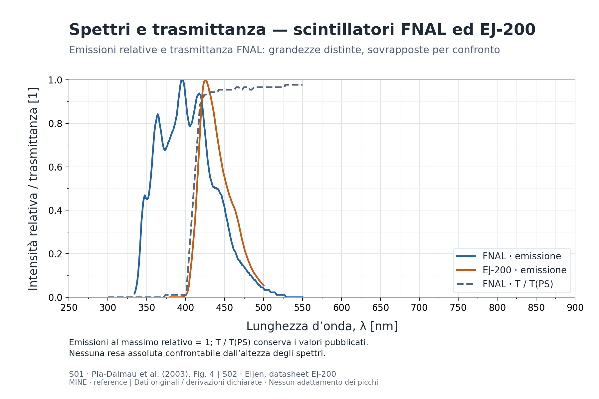

# Scintillator spectral profiles

Select in the explicit Geant4 optical config:

```
model=spectral_y11
scintillationSpectrum=fnal_extruded
scintillationEmissionConvention=photon_per_nm
```

`scintillationSpectrum` accepts `monochromatic` (historical/default 425 nm),
`fnal_extruded`, or `ej200`. Ready-to-use configs are
`experiments/mine/geant4_optics_fnal_extruded.conf` and
`experiments/mine/geant4_optics_ej200.conf`; pass one with `--optical-config`.
Broadband sources require the spectral WLS model, because the old effective
WLS absorption edge was defined only for a two-wavelength approximation.

These are **spectral profiles, not complete material presets**. Selecting one
does not change composition, Birks, refractive index, yield (8000/MeV), decay
(2.5 ns), or the current constant bulk absorption length (1000 mm). In particular,
the EJ-200 profile is an EJ-200-like emission spectrum, not a complete EJ-200
material model (Eljen quotes 10000/MeV, 2.1 ns decay, 0.9 ns rise, PVT base).
It affects explicit `--transport geant4` only; tabulated MC response files are
unchanged and are not recolored by this option.



## Emission sources and limitations

* **FNAL/NICADD extruded:** A. Pla-Dalmau, A. D. Bross, V. V. Rykalin,
  [Extruding Plastic Scintillator at Fermilab (2003), Fig.4](https://lss.fnal.gov/archive/2003/conf/fermilab-conf-03-318-e.pdf).
  Polystyrene with 1% PPO and 0.03% POPOP. The published curve is front-surface
  fluorescence under 310 nm UV excitation, measured on a 1 cm disk. Both PPO
  and POPOP bands are retained. It is a **fluorescence proxy**, not a calibrated
  charged-particle scintillation emission spectrum. The paper describes the blue
  emission maximum as 420 nm, but the plotted UV-excited spectrum also has a
  strong shorter-wavelength band; we do not replace it with a Gaussian at 420 nm.
  Plastic self-absorption and subsequent wavelength shifting by its dopants are
  not modeled in the present transport. Y11 absorption below its measured
  support (~350 nm) remains unresolved/zero. Consequently this profile is useful
  for sensitivity studies, not as a validated prediction of absolute light yield
  or timing for an unspecified Fermilab production batch.
* **EJ-200:** [Eljen EJ-200 datasheet, university mirror](https://courses.washington.edu/phys433/equipment/EJ200data-sheet.pdf).
  The same spectrum is shown in the
  [current official datasheet](https://eljentechnology.com/images/products/data_sheets/EJ-200_EJ-204_EJ-208_EJ-212.pdf)
  (August 2023, page 2); the older single-material sheet provides vector data.
  Peak ~425 nm; the displayed range ends at 500 nm with a small nonzero ordinate
  (~0.055 of peak). We exclude the unmeasured red tail beyond 500 nm and normalize
  over the displayed support; no invented extrapolation. This introduces a
  spectral-tail uncertainty. An independent radioluminescence measurement is
  [Mianowski et al. (2023), Fig.5](https://pmc.ncbi.nlm.nih.gov/articles/PMC10746763/).

Neither published ordinate explicitly settles photon-count versus radiant-power
density. Default `photon_per_nm` interprets it as dN/dlambda; `power_per_nm`
first divides by photon energy. Both then apply |dlambda/dE| to create dN/dE
for Geant4. Omitting that Jacobian would distort the generated spectrum.
Interpolation is linear in wavelength, then sampled on a 0.25 nm grid retaining
source vertices and narrow zero guards at support edges. No runtime download
or external CSV read is needed. Source vertices/version/policy enter opticalHash.

CSV files are source digitizations; the compiled header is generated from the
same values. They are not normalized probability masses. Reproduce with:

```sh
python3 scripts/extract_mine_scintillator_spectra.py \
  --fnal-pdf /path/fermilab-conf-03-318-e.pdf --ej200-pdf /path/EJ200data-sheet.pdf \
  --output-dir /tmp/scintillator-spectra
```

The script extracts colored line segments/vector vertices using Poppler.
FNAL vectors are quantized (~1 nm); repeated x values use the median distinct
ordinate. Axes calibration, source PDF checksums and assumptions are recorded in
`provenance.json`. No curve fitting, Gaussian replacement or smoothing is used.

## Search for wavelength-dependent bulk absorption

No reliable **absolute intrinsic absorption length versus wavelength** for these
exact materials was established from the examined public sources. The existing
constant `bulkAbsorptionLengthMm=1000` remains an explicit effective assumption.

FNAL Fig.4 supplies spectral transmittance, saved as
`fnal_relative_transmission.csv` (fraction, not percent). Its reference is an
equal-thickness pure-polystyrene disk, NOT air. Under a Beer-Lambert model with
comparable interface losses it constrains only excess extinction:

```
mu_sample(lambda) - mu_PS_reference(lambda) = -ln(T_relative(lambda)) / 10 mm
```

The absolute PS baseline is missing, and extinction does not distinguish
nonradiative absorption from absorption followed by fluorescence. Zero or unity
transmission in a digitized plot gives limits, not exact zero/infinite lengths.
This CSV is **research data only and is not installed as Geant4 ABSLENGTH**.
FNAL Table I gives 5/24 cm fast/slow attenuation measured along 1 m strips;
those include geometry/collection and cannot be substituted for microscopic
absorption lengths along individual photon rays.

Eljen quotes 380 cm light attenuation for EJ-200, but not its wavelength curve.
The older sheet describes ~4 m measured on 2 x 20 x 300 cm cast strips. This is
a technical attenuation measurement, with ray paths and boundary losses.
[Mianowski et al. (2023), Fig.8](https://pmc.ncbi.nlm.nih.gov/articles/PMC10746763/)
shows spectral absorbance, but all curves are normalized to unity because the
measurement geometry was not exactly reproducible. They cannot supply absolute
ABSLENGTH. Gamma-ray attenuation coefficients in Eljen's document library concern
ionizing radiation, not the generated optical photons.

For a spectral absorption model we need absolute optical transmission with known
path lengths and reflection correction (preferably two or more thicknesses), or
manufacturer-supplied intrinsic mu(lambda). Modeling PPO/POPOP self-absorption
and radiative re-emission would additionally need their spectra, quantum yields
and delay/energy-transfer model; treating all removed UV photons as lost would
not reproduce the complete scintillator physics.

## PNG di confronto

- [Emissione FNAL](fnal_emission.png), [emissione EJ-200](ej200_emission.png), [trasmittanza relativa FNAL](fnal_relative_transmission.png).
- [Confronto spettri e trasmittanza](spectra_and_transmission.png).

Formato comune 1800×1200 px, λ 250–900 nm, ordinate 0–1. La trasmittanza conserva il riferimento PS e non viene convertita in assorbimento assoluto. Galleria e rigenerazione: [reference/plots](../../../../../reference/plots/README.md).
