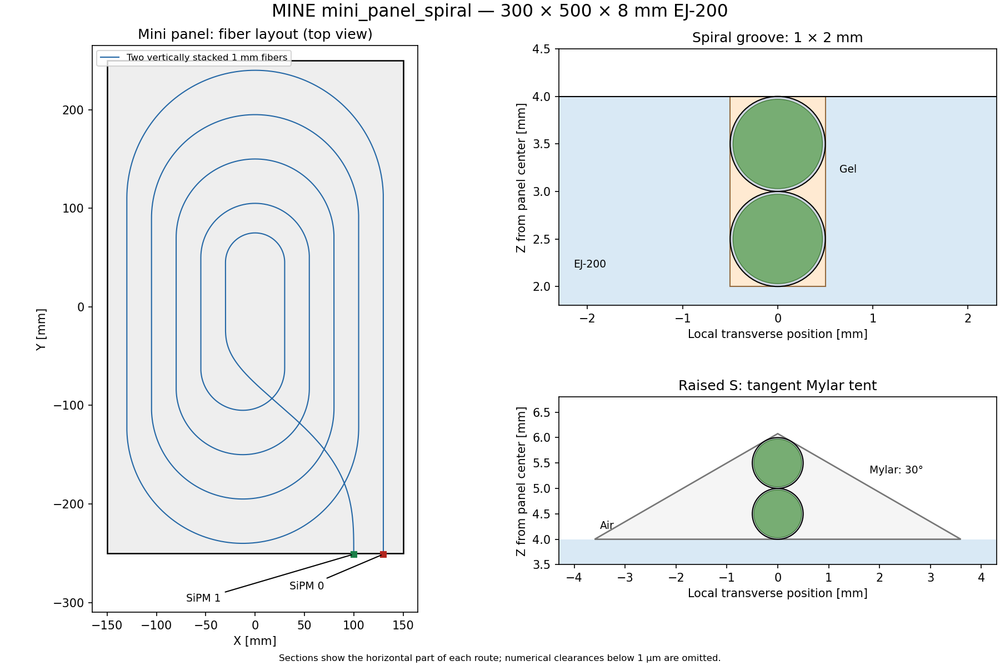

# Native Geant4 mini_panel_spiral

Implementation and numerical checks: 22–23 November 2026. This is an additional
GEMC variation; the external light-trapping MC and its production data are not
modified. Geometry is reconstructed from `MC_MINE_LightTrapping/config/mini_panel_spiral.conf`,
its `readout_mini_panel.conf`, `docs/mini_panel_spiral.md`, and
`src/MiniPanelSpiralGeometry.cpp`. SHA256 of inspected inputs are preserved in
[mini_panel_source_manifest.json](mini_panel_source_manifest.json).



## Geometry and explicit user choices

| Component | Native implementation | Provenance |
|---|---|---|
| Panel | 300 X × 500 Y × 8 Z mm; center at (0,0,0) | MC geometry |
| Fibers | Two independent 1-mm circular Y-11 Non-S fibers on the same XY spiral, vertically stacked | MC geometry; user selected Y-11 Non-S |
| Single cladding | PMMA, radial thickness 0.03 mm; core diameter 0.94 mm | MC config |
| Top groove | Rectangular 1 × 2 mm, open on +Z; groove floor at local Z=2 mm | MC geometry, distinct from the large-panel 2×2-mm groove |
| Spiral centers | Local Z=2.5/3.5 mm, equivalent to MC Z=6.5/7.5 mm | MC geometry |
| Raised S centers | Local Z=4.5/5.5 mm after lift | MC geometry |
| Groove filling | Thorlabs G608N3 optical gel, existing dispersion curve | User selection; manufacturer reference in [materials](mini_panel_materials.md) |
| External S | Air around the fibers, between plastic and Mylar | User input |
| Cover | Mylar spectral specular surface, tent sides 30° to panel, tangent to the upper fiber | User input; existing spectral dataset |
| Sensor 0 | Fiber cut at X=130,Y=−250 mm, paired-end center Z=3 mm | MC readout |
| Sensor 1 | Fiber cut at X=100,Y=−250 mm, paired-end center Z=5 mm | MC readout |
| Sensors | 3×3 mm each, plane normal −Y, 1 mm G608N3 gel between cut/panel edge and sensor | MC readout and user input |
| Direct light | Plastic is visible through the same sensor coupling; no opaque fiber-only mask | User input |
| Default SiPM | Ideal: PDE 1, no occupancy losses, dark noise or cross-talk; jitter 0 | User input |
| Optional SiPM | Hamamatsu S13360-3075CS spectral PDE and current simplified cell/noise model | User input; existing datasheet model |

Upper spiral radii are 130,105,80,55,30 mm; lower radii are 117.5,92.5,67.5,42.5 mm.
Straight sections are tangent to the semicircles. Total length is approximately
4278.664 mm per fiber (4001.946711 mm in the planar spiral before the S).

The S retains the source MC's fitted C2 centerline: the radial inflection quote
is 230 mm from the lower-left panel corner. The fitted shape parameter is
0.627147136639; lift finishes at 90% of the first crossing parameter. The S is
an assumed smooth route constrained by those measurements, not a fully surveyed
fiber path. Native support is for this measured panel, not a general importer
of arbitrary MC configuration files.

## Continuous solid construction and numerical precision

`mine_mini_spiral_model.{h,cc}` is portable analytic geometry. Spiral arcs are
exact; the three-dimensional S is approximated by adaptive G1 biarcs with
continuous tangents. The default `miniCurveToleranceMm=0.0002` gives 217 native
segments per fiber. An independent dense comparison gives maximum centerline
deviation **0.0000383082 mm = 0.0383 µm**.

Geant4 uses native toroidal/cylindrical tubes joined in balanced Boolean unions;
core is a daughter of its cladding. For nearly straight arcs whose sagitta is
below `min(0.00005 mm, miniCurveToleranceMm/4)`, a straight tube avoids loss of
precision in very large-radius tori. This adds at most 0.05 µm centerline
error. Adjacent internal caps overlap by 1 µm along the tangent, so they do
not introduce false optical boundaries. Physical end cuts are not extended.

In Geant4 10.7.4, a reproduced `G4Torus` negative-start-angle case classified
near-wall interior points as `kSurface` despite positive distance to the wall.
Tori therefore always start at phi=0; their basis is rotated to give the exact
same physical arc and cap extension. See the
[version-specific primary source](https://github.com/Geant4/geant4/blob/v10.7.4/source/geometry/solids/CSG/src/G4Torus.cc).
Both centerline and near-wall probes test the resulting native solids.

A literal 1-mm vertical translation of the two sloping S curves makes their
normal separation slightly less than 1 mm. The upper center gets the smooth
correction `3D(sqrt(1+(dz/dsXY)^2)−1)` during lift, peaking at **3.59635 µm** and
vanishing at both ends. Dense nearest-point checks between different curve
parameters find minimum separation ≥1 mm within 0.2 nm numerical tolerance.
This prevents finite-volume overlap without local tight detours.

The plastic is carved by the full groove. Gel is the intersection of that
channel with the original panel, minus the two fiber solids. Continuous fibers
are siblings of the carved panel and pass into the external air canopy; none
protrudes from its mother volume. The S groove and tent use closed 1200-station
lofts; only these external boundaries are faceted, not the optical fiber wall.
A clearance `max(0.0005 mm,2*miniCurveToleranceMm)` prevents mesh/tube numerical
intersections. The deterministic native containment check samples eight
azimuths per segment, inset by that tolerance: **3472 probes**. It includes
fiber/fiber, fiber/plastic, fiber/gel and fiber/air exclusions; it is not an
exhaustive mathematical proof or a generic randomized overlap scan.

For a horizontal upper fiber, tangent 30° roof sides meet at
`z_apex=z_center+r/cos(30°)`. The apex is 77.35 µm above the fiber's top;
setting the apex exactly at its top would cut into the circle. No physical
extra gap is added (`tentClearanceMm=0`); a submicron numerical clearance remains.
Plastic-to-canopy contact is an open dielectric boundary, not a Mylar wall.
Mylar is applied on the external plastic, groove openings and canopy envelope.
It is an optical surface, without a physical 10-µm foil mass/shape model.

## Optical response

The new presets are:

- `experiments/mine/geant4_optics_mini_panel_spiral.conf`: ideal SiPM.
- `experiments/mine/geant4_optics_mini_panel_spiral_hamamatsu.conf`: `sipmModel=hamamatsu`.

EJ-200 nominal properties are 10000 photons/MeV before Birks, rise 0.9 ns,
decay 2.1 ns, density 1.023 g/cm³, n=1.58 and the current full digitized EJ-200
emission spectrum. Finite-rise generation is enabled in the native optical
physics. Its actual Geant4 distribution, official sources and tests are in
[mini_panel_materials.md](mini_panel_materials.md).

Y-11 spectral absorption/emission, decay 6.9 ns, quantum-yield assumption 1,
and ordinary spectral losses shared by core/cladding use the latest
[Kuraray loss budget](wls_spectral_loss.md). The Y-11 long-wavelength curve is
still the explicitly documented YS-4/YS-6 coefficient proxy. No independent
4-m loss, effective trapping multiplier or additional WLS delay is applied.
YS-4/YS-6 can be selected in a copied mini optical config via `fiberModel` and
its corresponding `wlsDecayNs` (1.4/1.3 ns); geometry remains identical.

Mylar uses the existing Yang2021 spectral data and relative-standard albedo
assumption, rather than the toy MC's constant 98%. Gel uses dispersive n and
group velocity; absorption is ignored by the accepted approximation. No
toy-MC reflection limit, reflectivity fluctuation, unit capture probability or
zero WLS time is imported. Full Geant4 times/wavelengths reach the digitizer.

**Uncalibrated inputs remain:** plastic microscopic absorption 1000 mm and
Birks 0.126 mm/MeV; unity WLS quantum yield; Y-11 spectral-loss proxy; relative
Mylar calibration; surface microstructure and mechanical stress/microbending.
The specified 30-mm bend radius is tighter than the non-S mechanical guidance
(~100 mm). Native geometric bending loss is tracked, but stress degradation is
not measured. Plastic re-emission and Rayleigh scattering remain disabled by
the preceding accepted approximations. This implementation is numerically
tested, not experimentally validated.

## Running and output

From the repository root, with the existing GEMC Docker container running and
the new sources built:

```sh
scripts/run_mine.sh --gui --transport geant4 --geometry mini_panel_spiral
```

Click Run for one event in the GUI. The carved Boolean plastic is represented
by its outline and the fiber centerlines to avoid slow Boolean mesh rendering.
For N muons uniformly distributed over the full panel and along +Z:

```sh
scripts/run_mine.sh --batch --transport geant4 --geometry mini_panel_spiral -N=1000
```

The dedicated gcard supplies a 10-GeV muon, vertex Z=−100 mm, uniform
`SPREAD_V=(150,250,0)mm`; native command-line options can override it. Optional
nonideal sensor response:

```sh
scripts/run_mine.sh --batch --transport geant4 --geometry mini_panel_spiral \
  --optical-config experiments/mine/geant4_optics_mini_panel_spiral_hamamatsu.conf -N=10
```

Outputs and logs remain in `experiments/mine/output` by default. Mini requires
`--transport geant4`; tabulated mode and mismatched geometry/config fail early.
A zero gel gap or sensor dimensions different from 3×3 mm are rejected rather
than silently ignored. Legacy corner-specific pitch/inset config keys are
inactive in this measured mini geometry.

HIPO retains the current banks, with `fiberLayout=7`, `fiberCount=2`, Y-11
`fiberModel=0`, `responseMode=2`, `opticalTable=0`, `idealSiPM=1|0`, and optical
configuration/geometry hash. `MC::WLS` describes absorption ancestry;
`MINE::optical.entryFiber` describes the last fiber exited on the final route
to the sensor, preserved across the gel and reset on plastic re-entry. Direct
plastic light has `entryFiber=-1`. The immediately preceding material is now
usually `entryRole=Filler`, so it need not be core/cladding when entryFiber≥0.
The optical truth retains PDE-rejected arrivals (`detected=0`).

**Updated 23 November 2026:** the sibling overview now automatically recognizes
layout 7 and the matching optical hash, selects the 300×500×8-mm nominal panel,
uses this mini model and preserves fiber attribution through gel/air. It rejects
mixed conditions or unavailable configs. Current HIPO files need no regeneration.
Full geometry dimensions/transforms are not embedded in the old HIPO banks;
automatic sizes come from the supported nominal models. See the
[analysis documentation](../../simulation_time_resolution/README.md).

## Reproducible checks

`scripts/test_mine_mini_panel.sh --portable` checks the analytic model without
Docker. Without `--portable`, it also compiles/runs the native navigator and
100 optical-photon coupling cases. `--integration 1` additionally produces
one full particle event for each SiPM mode using the already compiled GEMC.
It records environments and source/config SHA256 in a new validation directory.
The GUI itself has not been exercised interactively in this validation.

The figure can be regenerated from the geometry CSV exported by the portable
test using `python3 scripts/plot_mine_mini_panel.py fiber_paths.csv output.png`.


Final evidence: [validation record](validation/mini_panel_20261123/README.md)
and [machine-readable results](validation/mini_panel_20261123/final_checks.json).
Both one-muon smoke tests collected 72/66 photons, with ideal detection 72/66
and Hamamatsu 34/31. Their tracked optical populations match at the same seed;
PDE is applied afterwards exactly once. The central-event cost was about 126 s
in the current Docker setup, not a production-average benchmark. No statistical
collection-efficiency or timing-resolution claim is based on two events.
